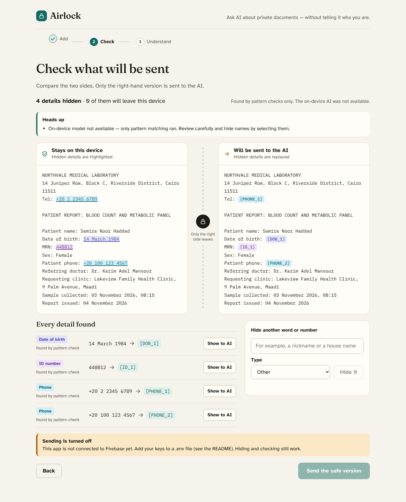

# Airlock

**Ask AI about private documents — without telling it who you are.**

Airlock explains confusing personal documents (blood tests, rental contracts, bank letters) using a powerful cloud AI, while your name, ID numbers, phone, address and account numbers never leave your device.

**Live demo: https://airlock-35fc7.web.app** (desktop Chrome for the on-device model, see [below](#turn-on-the-on-device-model-in-chrome))

Built for [#BuildHybridAI 2026](https://firebasehybridaihackathon.devpost.com/) with **Firebase AI Logic hybrid inference**.




## The problem

People hold documents they need explained but don't want to upload: blood test results, rental contracts, bank letters. Today they choose between privacy (keep it, stay confused) and help (upload it, hand a company their name, ID and health data). Airlock removes that trade-off.

## How it works

1. **Add** a document: paste text or choose a photo.
2. **On-device AI hides your details.** Gemini Nano, running inside Chrome, finds everything that identifies you and swaps each item for a placeholder such as `[NAME_1]`. A pattern check runs alongside it as a safety net. The list of real values (the "vault") stays in the page's memory and is never sent anywhere.
3. **You check** a side-by-side view: what stays on this device, and exactly what will be sent. You can hide more or un-hide anything.
4. **Cloud AI explains** the anonymised version.
5. **Your device puts the real details back** into the answer.

## Why this needs hybrid inference

Each model does a job the other cannot:

| Step | Firebase AI Logic mode | Why |
|---|---|---|
| Read a photo of a document | `ONLY_ON_DEVICE` | The raw document must not leave the device |
| Find personal details | `ONLY_ON_DEVICE` | Same. It can never silently fall back to the cloud |
| Explain the anonymised text | `PREFER_IN_CLOUD` | Needs a stronger model. Falls back to on-device when offline |

A final check runs before every cloud call: if any hidden value is still present in the outgoing text, the request is blocked.

Every answer shows where it was produced, using `response.inferenceSource`.

All model calls go through Firebase AI Logic (`firebase/ai`). See `src/lib/ai.ts`.

## Architecture

```
            ON THIS DEVICE                                   CLOUD
 ┌───────────────────────────────────────┐
 │ Photo ──► Gemini Nano (ONLY_ON_DEVICE) │
 │           transcribes the document     │
 │                                        │
 │ Text ──► Gemini Nano (ONLY_ON_DEVICE)  │
 │          + pattern safety net          │
 │          finds identifiers             │
 │                 │                      │
 │                 ▼                      │
 │   Vault: "Samira Haddad" = [NAME_1]    │   anonymised text   ┌──────────────────┐
 │   (never leaves the page)  ────────────┼───── leak gate ────►│ Gemini           │
 │                                        │                     │ (PREFER_IN_CLOUD)│
 │   Answer with real details  ◄──────────┼── answer with ──────│ explains it      │
 │   put back locally                     │   placeholders      └──────────────────┘
 └───────────────────────────────────────┘
```

| File | Role |
|---|---|
| `src/lib/ai.ts` | Every model call, through `firebase/ai`. Inference modes and the leak gate live here. |
| `src/lib/redact.ts` | Pure functions: pattern detection, the vault, placeholder swap and restore. Fully unit tested. |
| `src/lib/firebase.ts` | Firebase app, AI Logic and App Check setup. |
| `src/ui/` | The three screens: Add, Check, Understand. |

## Firebase products used

| Product | Used for |
|---|---|
| **Firebase AI Logic** (`firebase/ai`) | Hybrid inference: Gemini Nano on-device (`ONLY_ON_DEVICE`) and Gemini in the cloud (`PREFER_IN_CLOUD`) |
| **App Check** with reCAPTCHA Enterprise | Starts at page load and protects every AI Logic call |
| **Firebase Hosting** | The live demo |

## Try it (for judges)

1. Open **https://airlock-35fc7.web.app** in desktop Chrome.
2. Click an example under **Try an example**, for instance **Blood test report** (all examples are fictional).
3. Click **Hide my details**. The Check screen shows what stays on the device and exactly what will be sent.
4. Click **Send the safe version**. The cloud answer comes back with placeholders, and your device puts the real details back in.
5. Open **See exactly what the AI received** to confirm no hidden detail left the device.

On-device AI: if the status pill says **Download now** or **Start download**, click it. If it stays at 0%, turn on `chrome://flags/#gemma4-for-built-in-ai` and relaunch Chrome ([details](#turn-on-the-on-device-model-in-chrome)). Without the model the app still works with the pattern check (numbers, emails, labelled names, addresses and clinics).

## Built during the submission period

Everything in this repository was written for #BuildHybridAI 2026, starting 23 November 2026: the hybrid detection pipeline, the vault and leak gate, the three-step UI, the pattern safety net and its tests, and the App Check and Hosting setup. No pre-existing project code is included. Third-party code is limited to the open-source dependencies in `package.json` (React, the Firebase JS SDK, Vite, Vitest) and the Fraunces, Atkinson Hyperlegible and IBM Plex Mono fonts (SIL Open Font License) via Fontsource.

## Run it locally

Requirements: Node 20+, and desktop Chrome 139+ for the on-device model.

```bash
npm install
cp .env.example .env    # then fill in your Firebase web app config
npm run dev
```

### Firebase setup

1. Create a project in the [Firebase console](https://console.firebase.google.com/) and add a **Web app**. Copy its config values into `.env`.
2. Open **AI Services > AI Logic**, click **Get started**, and choose the **Gemini Developer API**.
3. Set up **App Check**:
   - Register the web app with the reCAPTCHA Enterprise provider and put the site key in `VITE_RECAPTCHA_ENTERPRISE_SITE_KEY`.
   - For local development, run the app once, copy the debug token printed in the browser console, and add it under **App Check > Apps > Manage debug tokens**.

### Turn on the on-device model in Chrome

1. Open `chrome://flags/#gemma4-for-built-in-ai` and set it to **Enabled**. This switches Chrome's built-in AI to Gemini Nano 4; without it, current Chrome can leave the older default model queued at 0% forever.
2. Open `chrome://flags/#prompt-api-multimodal-input` and set it to **Enabled** (needed to read photos), then click **Relaunch**.
3. Open Airlock and click **Download now** in the status pill. Chrome only starts the download after a click on a page that uses the model, and `chrome://on-device-internals` shows its progress. The first download is several GB.

Without the on-device model, Airlock still works in a reduced mode: only the pattern check runs. It catches numbers, emails, labelled names ("Patient name:", "Tenant:", "Dr."), street addresses and labelled clinics, and you select anything else it missed.

## Tests

```bash
npm test
```

## Limits

- The on-device model can miss an identifier. That is why the review step exists. Always read the right-hand pane before sending.
- Airlock gives general information, not medical, legal or financial advice.
- On-device inference currently needs Chrome on a desktop computer.

## License

Apache 2.0. See [LICENSE](LICENSE).
